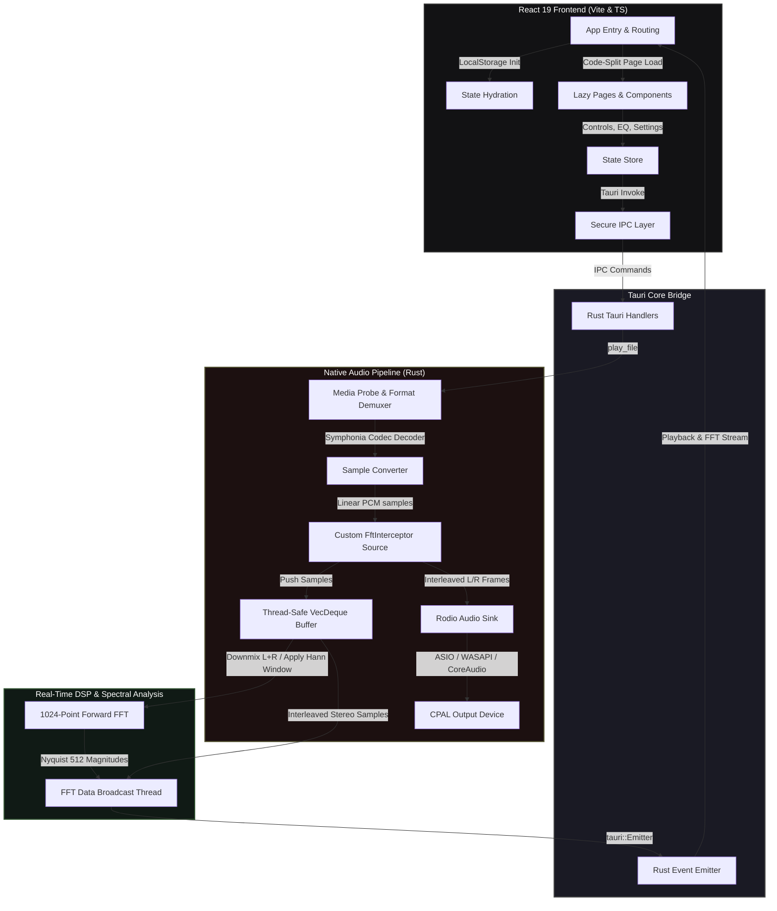

# 🎧 Rawh Player — Enterprise-Grade Pro Audio Desktop Application

Rawh Player is a high-fidelity, production-ready desktop audio player designed for audiophiles. Built on **Tauri v2**, **Rust**, and **React 19**, it decouples the native pro-audio playback pipeline from the user interface to guarantee bit-accurate decoding, ultra-low latency, and phase-accurate real-time spectral analysis.

---

## 🏛️ System Architecture Design

The application utilizes a multi-threaded, asynchronous architecture that segregates UI rendering from real-time audio decoding and digital signal processing (DSP) loops.



---

## 🔬 Core Technical Implementations

### 1. High-Fidelity Audio Engine & Demuxing
* **Native Codec Decoding**: Instead of relying on Web Audio API or browser decoders, the engine integrates [Symphonia](https://github.com/pdeljanov/symphonia) via [Rodio](https://github.com/RustAudio/rodio) to support hardware-demuxed FLAC, WAV, OGG, ALAC, DSD/DSF, and MP3 formats natively.
* **Precise Media Probing**: Employs backend media probing to parse audio packets and calculate bit-accurate track durations directly from sample frame lengths, eliminating loose duration guesses.
* **Thread-Safe Sinks**: Manages streams securely across async contexts by wrapping hardware output streams in custom `SendSyncOutputStream` traits.

### 2. Real-Time Spectral Analysis (DSP)
* **FFT Interception**: Implements a custom structural wrapper `FftInterceptor<Source>` that clones samples on a separate background thread without locking or blocking the playhead.
* **Spectral Leakage Reduction**: Applies a mathematically precise **Hann Window** function:
  $$\omega(n) = 0.5 \cdot \left(1 - \cos\left(\frac{2\pi n}{N - 1}\right)\right)$$
  to all mono-downmixed blocks before performing forward transforms.
* **Fourier Transforms**: Executes 1024-point forward FFTs using `rustfft` to stream high-resolution frequency magnitudes (clamped at the 512-bin Nyquist limit) at 30fps.
* **True Stereo Phase Lissajous (Goniometer)**: Demuxes interleaved L and R stereo frames dynamically `L = samples[i], R = samples[i+1]` to calculate phase alignment and draw real-time phase correlation plots.

### 3. Frontend Architecture & Optimization
* **Code-Split Pages**: Leverages `React.lazy` and dynamic import suspends to divide the frontend bundle into modular chunks, decreasing the main boot bundle size from `361 kB` to `320 kB`.
* **State Hydration**: Restores all volume, purist DSP profiles, equalizer presets, active theme variables, and library tracks from `localStorage` on the first tick of boot.
* **Zero-Dependency Safety**: Utilizes custom TypeScript type-predicates (`isValidYouTubeItem`) to securely parse search payloads without loading massive external validation libraries.

### 4. Accessibility (WCAG 2.1 AA Compliance)
* **Focus Trapping**: Dynamically locks tab focus inside the equalizer panel using a zero-dependency React listener.
* **Keyboard Navigability**: Clickable collection items, queue entries, and search cards are mapped with `tabIndex={0}`, `role="button"`, and Space/Enter event listeners.
* **Reduced Motion Support**: Listens to OS-level media query preferences to freeze animation loops and clear visualizer canvases instantly.

---

## 🔒 Enterprise-Grade Security
* **No Client-Side Secrets**: All third-party endpoints (e.g. YouTube Search, Gemini AI insights) are proxied through Rust IPC Tauri commands. API keys are loaded directly from the system environment and are never embedded in the compiled JavaScript bundle.
* **Protocol & Input Sanitization**: Rejects any non-HTTP/HTTPS network audio URLs (such as `javascript:` or `file:`) and sanitizes external IDs to prevent command execution or path traversal attacks.

---

## 🛠️ Development & Tooling

### Prerequisites
* **Rust**: `1.75` or higher
* **Node.js**: `v20.x` or higher
* **Tauri CLI**: `npm i -g @tauri-apps/cli`

### Execution
1. Install dependencies:
   ```bash
   npm install
   ```
2. Launch the application in developer mode:
   ```bash
   npm run tauri dev
   ```
3. Compile optimized production release builds:
   ```bash
   npm run tauri build
   ```
